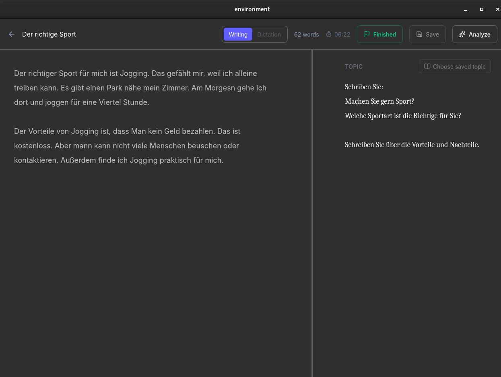
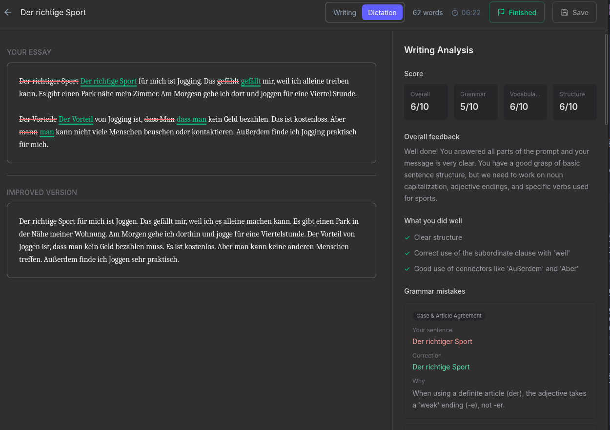
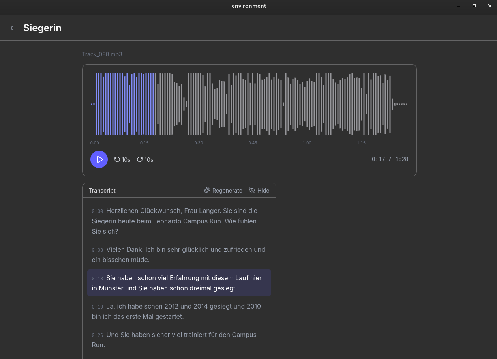

# German Learning Environment(minimalist)

Something that I needed for learning German :)

## What it actually does

### ✍️ Writing

I needed a writing environment(apart from Google Docs, why not? having my own dictation mode)

You can simply start writing, by a click.

- on the right your essay points that you should address (questions)
- on the left your master of art :)

When clicked on analyze button, it turns out:

### 🎧 🗣️ Listening

I always needed a audio play with Waves, so I can move back and forward over and over to hear the exact connected speech. What if the AI gives us the transcript of the Audio and then we can recheck?

## Getting started

1. Download the installer for your system from the [Releases](https://github.com/khalvai/environment/releases) page and install it.
2. Get a free API key from [Groq](https://console.groq.com/keys): sign in, open **API Keys**, click **Create API Key**, and copy the key (it starts with `gsk_`).
3. Open the app. On the home page, paste the key into the **Groq API key** card and click **Save key**.

The key is stored in your system keyring on your own device, and the app only uses it to call Groq for writing analysis, word explanations and audio transcripts. To change it, remove the saved key from the same card and add a new one.
